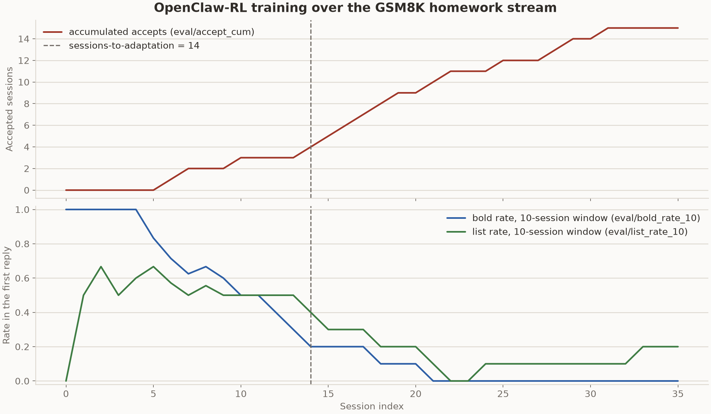

# Reef 上的 OpenClaw-RL

本示例实现了 [OpenClaw-RL](https://arxiv.org/abs/2603.10165) 个人智能体实验的 harness 侧。OpenClaw-RL 从智能体的日常使用中训练它：每一轮都由用户接下来的行为来评分，后续继续推进视为接受，抱怨则视为拒绝，策略在持续服务的同时进行更新。方法本身是 `openclawrl` recipe 包（`recipes/openclawrl/`）。其 processor 从 Reef 已记录的流量中重建会话，通过独立部署的 PRM 评判每一个已完成的轮次，并将被接受的事后提示转化为训练信号。无需调用 report。processor 优先使用稳定且会话唯一的 `x-reef-tag-session` 值，否则回退到匹配转录文本；本示例的 header shim 为未修改的 Hermes 智能体提供该标签。

本目录是围绕该 recipe 的实验：一个模拟学生把 GSM8K 作业题带给真实的 Hermes 智能体，一个会话接一个会话，指标是智能体需要多少个会话才能使其答案符合学生的偏好。学生希望解答看起来不像 AI 写的（自然的散文、无粗体、无列表），但仍要展示正确解答的每一步。它从不说明这一偏好，因此智能体必须从反应中学习。

[`openclawrl` recipe 页面](../../../../docs/user-guide/recipes/openclawrl.rst)记录了该 recipe 的配置。本 README 记录了该 stream 的实现细节以及一次完整运行的学习曲线。

```text
harbor-tasks/
  gsm8k-s000/ ... gsm8k-s071/   每个会话一个标准 Harbor 任务，按数据集顺序排列
    task.toml                    元数据、超时、智能体网络允许列表（仅 judge）
    instruction.md               告诉智能体的内容
    environment/
      Dockerfile                 hermes-agent，固定到某个提交
      Dockerfile.judge           FROM 共享学生服务镜像，加上本会话的 problem.json
      docker-compose.yaml        主容器 + judge 服务
      problem.json               本会话的问题和标准答案
    tests/test.sh                将 judge 的 /final 判定复制到 verifier 输出中
harness/
  agent.py                       HermesStreamAgent：运行一个会话的 reef-eval 智能体
user_sim/
  personas.py                    学生 persona 和严格的接受标准
  student_server.py              judge 服务（HTTP），脚本化或由 LLM 驱动
  pyproject.toml                 打包为 openclawrl-user-sim
  Dockerfile                     共享学生服务镜像，由 run.sh 构建
results/
  learning_curve.py              每个会话的接受和风格指标，在 stream 期间记录到 W&B 或事后导出
  2026-08-27-gsm8k-stream-qwen3-4b-thinking/
                                 一次完整运行的学习曲线
serve.yaml                       Reef/Slime 配置以及该 recipe 的 PRM 端点
docker-compose.yaml              Reef、PRM 和学生模型容器，使用独立的 GPU
run.sh                           构建学生服务镜像、启动技术栈、运行 stream
restamp.sh                       在 user_sim/ 内容变更后，将 72 个任务重新固定到其内容哈希
pyproject.toml                   使 harness/ 可导入
```

## 普通智能体

智能体是每个任务容器内标准安装的 `hermes-agent`。它通过命令行驱动，每条学生消息对应一次安静的 `hermes chat -q` 轮次（第一次之后使用 `--resume latest`，以便模型在上下文中保留自己之前的回复），其主目录位于 stream 的状态挂载上。一次性命令 `hermes -z` 不能用于此目的：它接受 `--resume` 但会忽略它，因此每一轮都会开始一段全新的对话。Hermes 从自己的配置中读取模型端点，并发送 OpenAI 兼容的聊天请求；它对 Reef、场景或训练一无所知。

judge 服务扮演学生。`student_server.py` 运行来自 `personas.py` 的 persona，对每条回复做出反应，并记录会话。反应来自技术栈所服务的 Qwen3-32B persona，由 `OPENCLAWRL_USER_LLM_URL` 和 `OPENCLAWRL_USER_LLM_MODEL` 指定；任务环境要求两者都必须设置。当 LLM 调用失败，或当 LLM 学生开始口述数学内容（persona 禁止这样做）时，脚本化台词作为回退：带风格的回复会收到抱怨，干净的回复会收到保存文件的请求。

## 作业 stream

该 stream 是一个 [reef-eval 任务 stream](https://github.com/Human-Agent-Society/reef-eval)：一个有序的普通 Harbor 任务文件夹，reef-eval 严格按顺序运行，并将一个目录（`$REEF_EVAL_STATE_DIR`）挂载到每个位置。智能体跨会话携带状态，因此这些会话不能作为独立试验运行。

已提交的 stream 将原始 OpenClaw-RL 论文中的 72 道 GSM8K 问题作为 72 个任务。每个任务都是一个标准 Harbor 任务，其环境仅携带自己的 `problem.json`；judge 作为由单个共享镜像构建的 compose 服务运行。

学生服务根据智能体的第一条解答回复对每个会话评分，遵循 `personas.py` 中的严格标准：无 AI 风格标记（粗体、标题、项目符号或编号列表、水平分割线、表格、`\boxed`、"final answer:"），至少两个可见的计算步骤，并且包含标准答案。

权重和记忆是智能体适应的两种不同方式。论文中的数字仅针对权重，因此 `hermes_memory` 默认关闭。

## 为 Reef 所需的更改

`HermesStreamAgent`（`harness/agent.py`）为每个 stream 位置拥有一个会话。围绕未修改的智能体，它做了三处更改：

1. 它在主机上运行一个小的 header shim（`reef_client.serve`），并将 hermes 的模型端点指向它。Hermes 无法自行设置 `x-reef-scenario` 或 `x-reef-tag-session` 头，因此 shim 附加场景和稳定的会话标签，然后将请求转发给 Reef。
2. 它在位置 0 生成一个 Reef 场景 id 并将其写入 `$REEF_EVAL_STATE_DIR`。一个 stream 就是一个场景，也就是 Reef 中一条运行时加载 ID 链。
3. 它在每个位置开始时写入 hermes 配置，关闭上下文压缩、推理显示和 tirith 扫描器（stdout 上的回复必须仅为答案）。

运行时流程为：

```text
reef-eval 为下一个会话启动任务容器和 judge 服务
  -> harness 从学生服务读取学生的消息
  -> hermes 运行一轮；其模型调用通过 shim 发往 Reef
  -> SGLang 后端记录采样的 token、损失掩码、对数概率和 top-K 捕获
  -> harness 将 hermes 的回复发布到学生服务，学生做出反应
  -> 在下一次模型调用时，processor 使用会话标签将前一次调用绑定到其后续的工具结果或用户反应
  -> PRM 评判该下一个状态，并可能提出事后提示
  -> batch_size 个已评判轮次形成一个批次；top-K select loss 训练策略
  -> Megatron 执行一次优化器步骤并将权重同步到 SGLang
  -> 下一个会话在更新后的权重上运行
```

## 设置（一次性）

你需要一台有七个可用 GPU 的 GPU 主机、Docker 和 `uv`（用于 `uvx`，它运行 reef-eval）。本示例的 `docker-compose.yaml` 将物理 GPU 1 分配给 PRM，GPU 2 分配给学生模型，GPU 3–7 分配给 Reef/Slime，GPU 0 保持空闲。Slime 为 Megatron actor 保留四个 GPU（张量并行 4），为一个策略 rollout 保留一个。其 CPU 驱动本身不保留任何模型 GPU。根据你的主机调整 Compose 设备分配；保持三个池互不重叠。本示例是单主机部署。

Compose 启动并健康检查独立模型服务，在启动 Reef 前等待 PRM 就绪，并在 harness 运行前等待所有三个服务就绪。Reef 为 Slime 启动本地 Ray 运行时，并将其 HTTP 服务连接到训练所拥有的推理引擎。Reef 关闭时停止自己的运行时；`docker compose down` 停止整个示例，包括 PRM 和学生模型。

仅在将 Slime 连接到外部集群时设置 `RAY_ADDRESS`，Reef 会让该集群保持运行。该集群必须排除 PRM/学生 GPU：Reef 容器的 GPU 可见性不会约束外部集群。不可用的外部地址会报错。要直接启动 Reef，请先启动独立的 PRM 和学生模型，然后限制 Reef 的本地池，例如：
`CUDA_VISIBLE_DEVICES=3,4,5,6,7 reef serve -c recipes/openclawrl/examples/openclawrl/serve.yaml`。

```bash
docker build -f docker/Dockerfile.reef -t reef-openclawrl .
hf download Qwen/Qwen3-4B-Thinking-2507 --local-dir ~/models/Qwen3-4B-Thinking-2507   # 策略和 PRM
hf download Qwen/Qwen3-32B --local-dir ~/models/Qwen3-32B                             # 学生
pip install uv
```

Qwen3-4B-Thinking-2507 同时充当策略和 PRM，与参考运行脚本一致。PRM 是在其自身引擎上的冻结基础模型；策略则被训练。Qwen3-32B 扮演学生。

在你未亲自设置的机器上还有两件事需要检查。reef-eval 需要 Python 3.12 或更新版本；如果 `uvx` 选择了较旧的解释器，请设置 `UV_PYTHON=3.12`。并且仓库根目录不得包含过期的 `reef.egg-info`，因为它会被挂载到容器中并遮蔽已安装包的入口点，从而导致 sglang 插件无法加载。

## 运行

```bash
OPENCLAWRL_USER_LLM_URL=http://<host-ip>:30001 \
OPENCLAWRL_USER_LLM_MODEL=qwen3-32b-user-llm \
bash recipes/openclawrl/examples/openclawrl/run.sh
```

这会构建学生服务镜像，在 Docker 中启动训练技术栈（在 B200 上约六分钟），等待其变为健康状态，然后通过 reef-eval 运行 72 个会话的 stream。stream 结束后技术栈会继续运行。重新运行同一命令会从实验中断处恢复 stream，并复用健康的技术栈。

路径和名称是 `run.sh` 顶部的常量：`~/models` 下的模型、`~/reef-run` 下的检查点，以及任务列表（全部 72 个 GSM8K 任务）。少数设置来自环境变量，因为任务环境和其他进程会读取它们：

- `OPENCLAWRL_USER_LLM_URL` 和 `OPENCLAWRL_USER_LLM_MODEL` 指定技术栈在端口 30001 上服务的学生模型。任务环境要求两者都必须设置，当任一未设置时 reef-eval 会拒绝每个任务。请使用主机的地址而非 localhost，因为学生服务是从容器内部调用它的。
- `WANDB_API_KEY=...` 会被转发到技术栈中用于实时训练曲线（同时还需在 `serve.yaml` 中设置 `observability.wandb.enabled: true`），并启动 `results/learning_curve.py`，它将每个会话的判定记录到同一个 W&B group 中。

一个 reef 进程在其生命周期内训练一个场景。将不同的 stream 名称或全新的运行目录指向已经训练过的技术栈会被拒绝，并提示 "training is already bound to scenario ..."。在切换 stream 或启动变体之前，请在本目录中使用 `docker compose down` 停止技术栈。

已停止的技术栈会从 `$RUN_DIR` 重启：actor 恢复其 Megatron 检查点，teacher 从基础 HF 权重重新加载，已提交的 head 被重新发布。有两种情况需要手动处理：

- 当 Reef 正在提交某个步骤时停止（在 bridge 已发布其权重之后），会使 bridge 等待该提交，之后每个批次都会被拒绝，并提示 "training marker is READY_TO_COMMIT; operator recovery required"。该批次无法重放（judge 会采样），因此请重新开始训练状态：停止技术栈，并将 `checkpoints`、`artifacts.git`、`artifact-work`、`artifact-cache`、`agent-record` 和 `prm-records.jsonl` 移出 `$RUN_DIR`。实验和 stream 状态会保留，重新运行会从下一个位置继续。
- harness 以你的用户身份运行每个容器命令（包括 hermes），并在每个位置开始时将 hermes 主目录交给你，因此被终止的运行不会在 `$REEF_EVAL_STATE_DIR/lab/streams/<stream>/state` 中留下 reef-eval 无法重置的 root 所属文件。由较早的 harness 写入的状态目录可能仍需要一次性 chown 给你的用户。

### 解读一次运行

reef-eval 实验位于 `~/reef-run/lab`。每个会话的判定在 `trials/gsm8k-sNNN__*/verifier/final.json` 中，包含奖励、违反规则列表和轮次计数。`results/learning_curve.py` 将这些判定转化为 stream 的学习曲线：第一条回复是否被接受、judge 标记了哪些风格标记（粗体、项目符号、编号列表）、累计接受数。当 stream 在如上所述设置了 `WANDB_API_KEY` 的情况下运行时，`run.sh` 以日志模式运行该脚本，每个会话作为与训练运行同一 W&B group 的 `eval` 运行中的一个点出现。stream 结束后，同一脚本将这些点导出为 CSV，并绘制 README 中保留的图：

```bash
uv run --no-project --with matplotlib \
    recipes/openclawrl/examples/openclawrl/results/learning_curve.py \
    --lab ~/reef-run/lab --csv results/<run>/learning_curve.csv --plot results/<run>/learning_curve.png
```

## 结果

### GSM8K 作业 stream

`results/2026-08-27-gsm8k-stream-qwen3-4b-thinking/` 是上述运行的一次结果。

| 设置 | 值 |
| --- | --- |
| 任务 | 72 个会话的 GSM8K 作业 stream，hermes 记忆关闭 |
| 模型 | `Qwen3-4B-Thinking-2507` 作为策略和 PRM |
| 学生 | `Qwen3-32B` persona |
| 硬件 | 七 GPU 参考布局：一个张量并行 4 的 actor、一个 rollout 引擎、一个 PRM 引擎、一个用于 Qwen3-32B 学生的引擎 |
| 批次 | 每个训练步骤 16 个已评判轮次 |
| 回复 | 在 65,536 token 上下文中最多 8192 token |
| 目标 | top-K select loss，PPO clip 0.2 / 0.28，`w_rl` 1.0，`w_opd` 1.0，top-4 捕获，`sequence_optimal` 提示选择 |
| 采样 | temperature 0.6，top-p 0.95，top-k 20 |
| 优化器 | Adam，lr `1e-5` 恒定，weight decay 0.1，betas 0.9 / 0.98 |
| 检查点 | 每个版本一个检查点，每步后热交换权重 |
| 跟踪 | 每个会话的判定在线记录到 W&B；训练指标未跟踪 |



当智能体的第一条解答回复已经符合学生的偏好、展示了过程且答案正确时，该会话通过。学生希望作业看起来不像 AI 写的，因此使用粗体文本或项目符号/编号列表的回复会招致抱怨。粗体率和列表率衡量整个运行中的这一习惯，即最近十个会话中第一条回复仍包含粗体文本或列表的比例。从曲线中我们看到两者随着训练进行而下降，该运行在第 14 个会话达到论文的适应标准（连续三个通过的会话）。


上面的演示重放了本次运行中的两个会话。在第 1 个会话中，学生拒绝了一条格式化回复，reef 继续训练，到第 16 个会话时第一条回复直接通过。

## 配置归属

Reef YAML 不包含任何 `service` 或 `services` 部分。HTTP 设置使用 `reef.*`；Reef 组装推理和训练。OpenClawRL 通过 `recipe.config.prm-url` 和 `recipe.config.prm-tokenizer-path` 消费独立部署的 PRM。tokenizer 必须与所服务的 PRM 匹配。CLI 覆盖使用相同的路径，例如：

```bash
reef serve -c recipes/openclawrl/examples/openclawrl/serve.yaml \
  --recipe.config.prm-url http://prm-host:23001 \
  --recipe.config.prm-tokenizer-path /models/prm-tokenizer
```

本示例的 Compose 文件拥有 PRM 和学生模型的启动参数、健康检查和 GPU 分配。在这些容器的命令中配置原生 SGLang 选项。学生模型端点属于用户模拟 harness；Reef 不会收到它。要在 Compose 示例中使用现有的 PRM，请移除 `prm` 容器和 Reef 的 Compose `depends_on: prm` 条目，然后更新两个 recipe 客户端字段。PRM 请求超时和评分错误仍由 OpenClawRL recipe 负责。